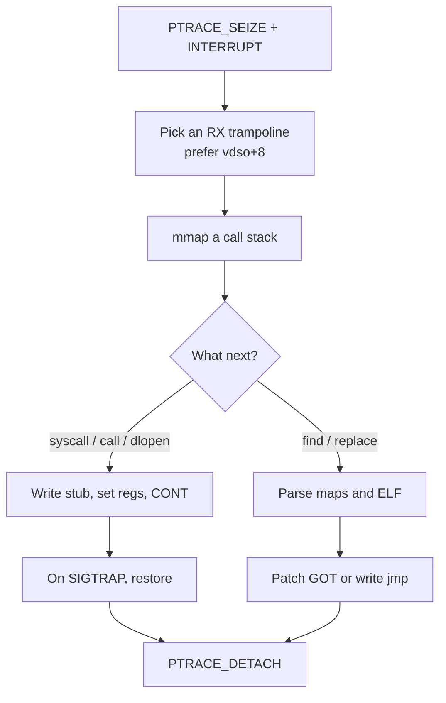
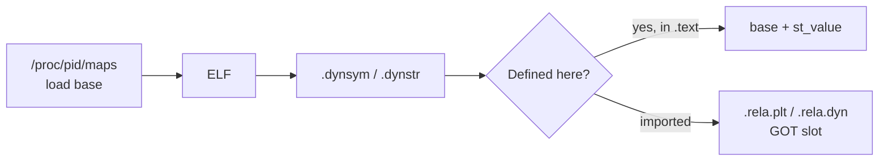
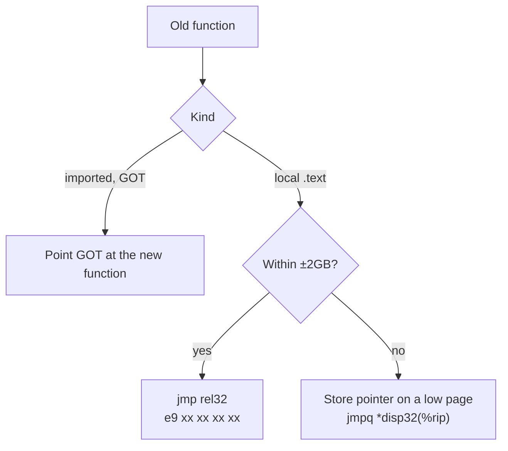

# hookso

[](https://github.com/esrrhs/hookso)
[](https://github.com/esrrhs/hookso)
[](https://github.com/esrrhs/hookso/actions)

hookso uses `ptrace` to take over another process and, in that process's address space, run syscalls, load or unload `.so` files, look up symbols, and replace functions. It targets **x86-64 Linux**. The implementation lives in a single `main.cpp` so the control flow is easy to follow.

[中文](./README_ZH.md) · [Usage details](./README_USAGE.md)

## What it can do

- Run a syscall in the target, or call a function in an already-loaded `.so`
- `dlopen` / `dlclose` to attach or unload a library
- Find a function address and read arguments of the next call
- Replace an old function (or an arbitrary address) with a function from a new `.so`, and restore it later
- When a target function is **about to run**, fire a syscall / call / dlopen / …

## How it works

hookso does not start a helper thread inside the target. It stops the process, writes a few instructions into memory that is already executable, points RIP at that stub, lets the target run the work itself, then restores the original bytes and registers.



### 1. Attach

`PTRACE_SEIZE` + `PTRACE_INTERRUPT` obtains a classified ptrace stop without
injecting an attach `SIGSTOP`. Real signals racing the initial interrupt are
forwarded in the original business context. Only a single-threaded target that
remains single-threaded is supported; existing multithreaded targets are rejected
before attach. Memory and register access happen while the traced thread is stopped.

### 2. Trampoline: 8 bytes of code in the target

To make the **target** execute `mmap`, `dlopen`, or an arbitrary function, hookso needs executable memory in that process for a short stub.

| Purpose | Bytes | Meaning |
|---------|--------|---------|
| Remote syscall | `0f 05 cc` | `syscall; int3` |
| Remote call | `ff d0 cc` | `callq *%rax; int3` |

`int3` returns control to hookso. Completion requires the expected `SIGTRAP`
source **and RIP = trampoline + 3**, not merely any `SIGTRAP`. The original
8 bytes, general registers, `orig_rax`, extended x87/SSE/AVX state, and signal
mask are restored. Host syscall restart state is preserved rather than reused
for the injected operation.

During remote execution, asynchronous business signals are temporarily
blocked with `PTRACE_SETSIGMASK`: `SIGCHLD`/`SIGPROF` remain kernel-pending until
the host context is restored and execution resumes. Standard signals can still
coalesce normally; this is not an exact event queue. No business handler is
intentionally run on temporary registers/stack. Synchronous fault signals
remain unblocked (to avoid Linux resetting a blocked fault handler to default),
but ptrace intercepts them before handler delivery. An external `SIGTRAP` aborts the
operation and is delivered after restoration; an unexpected synchronous trap
or fault in injected code is reported as injection failure, not success.

Trampoline location, in order:

1. **`[vdso] + 8`**: vdso is a small ELF the kernel maps, almost always `r-xp`. Offset 8 is `e_ident[8..15]`, normally padding.
2. An **executable** libc mapping that includes the ELF header, plus 8 (older distros often map the whole first segment `r-xp`).
3. Start of libc `.text` (overwrites real instructions; last resort).

```text
e_ident:
  +0  7f E L F
  +4  class / data / version / osabi
  +8  padding      ← stub goes here
```

`libc_base + 8` is not always valid. Current glibc maps the ELF header as **`r--p`**. Executing there SIGSEGVs, which is why vdso is preferred.

Remote syscalls use the Linux convention: `rax` = number, `rdi rsi rdx r10 r8 r9` = args. Remote calls use SysV: `rdi rsi rdx rcx r8 r9`, plus an `mmap`'d stack with 16-byte-aligned `rsp`. String arguments are copied into a page allocated in the target, then passed as a pointer.

### 3. Reading and writing memory

Tried in order:

1. `process_vm_readv` / `process_vm_writev`
2. `pread` / `pwrite` on `/proc/<pid>/mem`
3. `PTRACE_PEEKTEXT` / `POKETEXT`

Ptrace poke can write RX pages, so the vdso / `.text` stub can be installed. Short reads or writes are treated as failure.

### 4. Finding a function in a `.so`



- A basename such as `libtest.so` is parsed from **target memory**. If section headers are not mapped, that fails with I/O error.
- A **filesystem path** parses the file, then adds the load base from maps. Use this for large libraries such as `libstdc++`.
- libc may appear as `libc-2.17.so` or `libc.so.6`. Injection tries `__libc_dlopen_mode` first, then public `dlopen` (the private symbol is gone in glibc 2.34+).

Internal vs imported symbols later pick different patch strategies.

### 5. Replace: GOT, near jump, far jump

hookso `dlopen`s the new `.so`, then patches the old site:



- **PLT/GOT**: only that `.so`'s imports change. `puts` inside `libtest.so` becomes `putsnew`; other modules keep the original `puts`.
- **Near jump**: `jmp rel32` is a signed 32-bit displacement (±2GB), not 4GB.
- **Far jump**: a non-PIE binary at `0x40...` cannot `rel32` to a `.so` at `0x7f...`. hookso allocates a page in the low 32-bit range, stores the new pointer, and writes `ff 25 disp32` (`jmpq *offset(%rip)`).

`setfunc` / `setfuncp` write the saved 8 bytes or GOT value back.

### 6. Catching one call: `arg` / `trigger`

A thread-local hardware execution breakpoint waits for the next entry:

- `SIGTRAP` must have `TRAP_HWBKPT` and RIP equal to the requested entry
- Real business signals, including application `SIGTRAP`, are forwarded normally
- Original debug registers are restored; existing active hardware breakpoints are refused
- No entry bytes are modified, and Linux does not copy this ptrace hardware breakpoint into fork children
- Arguments are read as `rdi, rsi, rdx, rcx, r8, r9`
- `trigger` accepts `@1` for the first argument of the call just caught

Thus a single-threaded parent may keep forking while `arg` waits, without
fork children inheriting a temporary entry `int3`. The parent's normal fork
loop is **not** running concurrently when that same thread executes a remote call.

### Cancellation and support boundaries

`HOOKSO_TIMEOUT_MS` sets a per-wait deadline (default 10000 ms, valid range
1..3600000). SIGINT/SIGTERM/SIGHUP/SIGQUIT request cancellation. Recovery uses
`PTRACE_INTERRUPT`, restores breakpoint/context state, and checks detach errors.
A business job-control signal interrupts the operation instead of being swallowed.

**Not transactional:** aborting an arbitrary C/C++ call cannot roll back its
heap/TLS/errno changes, acquired locks, constructors, I/O, or other side effects.
After a remote-call abort hookso does not execute further remote cleanup calls;
it reports retained temporary mappings and possible callee side effects. SIGKILL,
uninterruptible kernel waits and failed ptrace recovery cannot guarantee cleanup.
Do not inject into an arbitrary non-reentrant runtime critical section; prefer a
cooperative Lua/host safe point. This does not make all programs injection-safe.

The target must not create threads during the session. Remote callees and
constructors must not fork/exec, change the signal mask, or wait for blocked
signals/handlers; these behaviors are unsupported. Direct fork/clone/exec syscall
injection is explicitly refused. Arbitrary callees/constructors are not
syscall-sandboxed, so those preconditions are not dynamically enforced.
No all-thread freeze is used. Children created
by normal business fork are not traced; they may inherit unused temporary data
mappings and persistent library/hook state. Parent cleanup does not clean child
snapshots. Successful child exec replaces the old image; the pre-exec window and
exec failures still matter. pLua session/timer/output-file fork policy is outside
this injector fix.

## Quick start

```bash
./build.sh
cd test && ./build.sh && ./test &
PID=$!

../hookso find $PID ./libtest.so libtest
../hookso syscall $PID 1 i=1 s="haha" i=4
```

Full command list and walkthrough: **[Usage](./README_USAGE.md)**.

```bash
./hookso syscall  <pid> <nr> i=1 s="str"
./hookso call     <pid> so func i=1
./hookso dlopen   <pid> ./new.so
./hookso replace  <pid> old.so old new.so new
./hookso arg      <pid> so func 1
```

Tests (Linux x86-64, ptrace required; CI sets `yama.ptrace_scope=0`):

```bash
bash test/run_tests.sh
python3 test/run_fork_tests.py --hookso ./hookso --repeat 5
```

The fork suite builds owned fixtures in a private temporary directory. It covers
fork and fork+exec parent liveness/reaping, real dlopen constructors, deferred
SIGPROF/SIGCHLD, signal storms, application/unexpected traps, SIMD state, blocked
read restart, timeout/cancellation, job-control preservation and multithread
rejection. It reaps fixture descendants and logs each cleanup; no real service
process is attached. `HOOKSO`/`TEST_DIR` can override legacy-suite build paths.

## Limits

- x86-64 only; syscall / call / dlcall take at most 6 integer or string arguments
- `replace` requires matching signatures or the target will crash
- Single-thread targets only, including throughout the session; multithreaded targets are rejected
- If a `.so` is not fully mapped, pass a **file path** instead of the soname

## Who is using it

[cLua](https://github.com/esrrhs/cLua) · [pLua](https://github.com/esrrhs/pLua) · [dLua](https://github.com/esrrhs/dlua) · [wLua](https://github.com/esrrhs/wLua)
